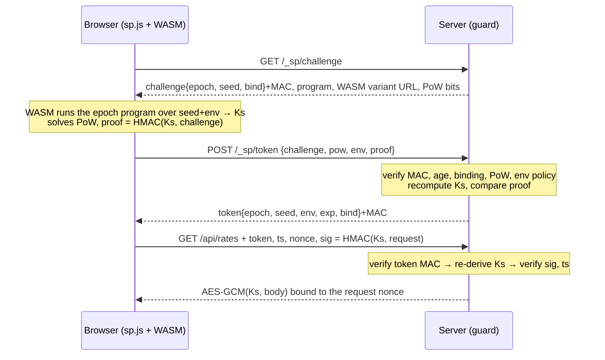

# Stateless Protection — architecture and research notes

A Go package (`guard`) plus a browser WASM client that protects public HTTP
endpoints against bulk scraping, form/write abuse and direct API replay,
without server-side sessions.

## 1. What this can and cannot do

Anything a browser can do, a determined attacker can eventually do too. The
honest goal is therefore **cost**, not impossibility:

- a script that calls the API directly gets nothing;
- a captured request or response is useless to anyone else, and useless to
  the same client after 30 seconds;
- reverse-engineering work expires: every 5 minutes for the program, at every
  pool rebuild for the decoder itself;
- every token and every write costs CPU, so volume costs money.

What it does **not** stop: a real (headless) browser driving the real site.
That attacker gets data at browser speed and pays the proof-of-work each
time. Slowing them further needs signals this design leaves as extension
points (section 7).

## 2. Research: weaknesses in the starting ideas

| Starting idea | Weakness | What the design does instead |
|---|---|---|
| Server sends `"op": "A"` this hour, `"op": "B"` next hour | A fixed menu of operations is reversed once. After that, rotation costs the attacker nothing | Each epoch gets a *generated program*: 64 random instructions with random operands, derived from `HMAC(secret, epoch)`. There is no menu to enumerate |
| Rotate hourly | A leaked key or reversed step works for up to an hour | 5-minute epochs, 10-minute tokens, 30-second request window |
| XOR / bit-shift decoding protects the data | Encoding is not encryption. Once understood it is free forever | Standard primitives carry the security (HMAC-SHA256, AES-256-GCM). The polymorphic part only hides *how the session key is derived* |
| Compiling to WASM hides the logic | The attacker does not need to read it. They download the `.wasm` and run it in Node — no browser, no reverse engineering | The WASM reports its environment and mixes it into the key; the server refuses non-browser environments. Variants rotate. Proof-of-work makes even a perfect emulator pay |
| "Forces the attacker onto Puppeteer" | At best true, and headless browsers are cheap | Stated plainly as the ceiling; PoW and optional signals add cost on top |
| Fully stateless | Strict one-time use and rate limits are impossible with zero state | Stateless core. One optional, pluggable replay cache for routes that need exactly-once |
| Client decides the current hour | Clock skew breaks real users | Epoch and time base come from the server in the challenge |

## 3. Design



The server stores nothing per client. On every request it recomputes the
session key `Ks` from the master secret and the fields inside the MAC'd token.

### Layer 1 — challenge and token

- The challenge is MAC'd and carries the epoch, a random seed, an expiry
  (2 min) and a **binding**: a keyed hash of the User-Agent, optionally plus
  the client's /24 or /64. A token moved to another client fails.
- To get a token the client must (a) run the epoch's program correctly,
  proven by `HMAC(Ks, challenge)`, and (b) solve a hashcash puzzle
  (default 16 bits ≈ 65k SHA-256).
- The token is `kid.payload.mac`. `kid` selects the master key, so secrets
  rotate without invalidating live tokens.

### Layer 2 — signed requests

Every protected request carries the token and
`HMAC(Ks, method, path, query, SHA256(body), timestamp, nonce)`.
The server rejects a timestamp more than 30 s off, so a captured request
cannot be moved to another URL, given another body, or replayed later.
Write routes also require a per-request PoW stamp bound to the signature,
and can demand exactly-once delivery through the optional `NonceStore`.

### Layer 3 — sealed responses

Routes with `Policy.Seal` return AES-256-GCM ciphertext under a key derived
from `Ks`, with the request nonce as associated data. A scraper that
captures traffic, or replays someone else's signed read inside the 30 s
window, receives bytes it cannot read. Cost: sealed responses are
per-session and cannot be cached by a CDN.

### Layer 4 — polymorphism

Two independent clocks:

- **Per epoch (5 min):** the program changes. A scraper that hard-coded the
  previous program derives the wrong key and is refused a token.
- **Per pool build:** the *decoder* changes. `cmd/spgen` derives N variant
  specs from a pool seed. Each spec shuffles the opcode numbering, register
  mapping, immediate mask, per-operation constants and final salt, and is
  emitted as **generated Go code with those values inlined**, then compiled
  to its own `.wasm`. The server picks a variant per epoch. Rebuilding the
  pool with a new seed (for example nightly in CI) invalidates every
  re-implementation at once.

The server runs the same semantics through a table-driven interpreter
(`internal/vm`). The end-to-end test builds a pool and proves every generated
variant agrees with it.

### Extras

- **Decoy mode** (`Policy.Decoy`): rejected requests get plausible fake data
  instead of a 403, so a scraper does not learn that it broke.
- **Reject reasons** go to `Config.OnReject` only. Clients always see the same
  generic 403.

## 4. Threats and answers

| Attack | Result |
|---|---|
| `curl` / script calling the API | 403 (or decoy): no token |
| Forged token or headers | 403: MAC needs the master secret |
| Replay a captured request later | 403 after 30 s; immediately, on `OneTime` routes with a store |
| Replay a captured sealed read within 30 s | Gets ciphertext only |
| Reuse a signature for another URL or body | 403: both are signed |
| Copy a token to another machine or tool | 403: binding mismatch |
| Re-implement the key derivation in Python | Works until the pool is rebuilt; program data changes every epoch |
| Run the site's WASM in Node | Refused by the environment policy — until the attacker fakes the probes (see limits) |
| Real headless browser | **Succeeds**, at browser speed, paying PoW per token and per write |

## 5. Limits, stated plainly

1. `Ks` is derived from values the client holds. The protection is that
   deriving it requires running code that keeps changing — obfuscation with
   an expiry date, not a secret.
2. The environment probe is basic (window, document, `navigator.webdriver`,
   Node). An attacker who reads the WASM can fake it.
3. Without a `NonceStore`, a signed request can be repeated for 30 s. For
   sealed reads that is harmless; for writes, enable the store.
4. No per-client rate limit without state. PoW bounds requests per CPU-second
   instead.
5. Requires JavaScript and WebAssembly, and a CSP that allows
   `wasm-unsafe-eval`. Search-engine crawlers cannot read sealed endpoints.
6. User-Agent binding is weak on its own; `BindIP` strengthens it but
   breaks clients that change networks mid-session.

## 6. Prototype status

Measured on the development machine:

| | |
|---|---|
| WASM size per variant, TinyGo 0.44.0 | 141 KB |
| WASM size per variant, standard Go compiler | 2.5 MB |
| First sealed read including handshake, WASM load and 16-bit PoW | 60–430 ms |
| Signed + sealed read afterwards | 2–5 ms |
| Signed write with 12-bit PoW | 2–28 ms |
| Dependencies | none beyond the Go standard library |

- Both compilers are supported and pass the same end-to-end test
  (`SP_E2E_COMPILER=tinygo go test ./e2e/`). **TinyGo is the recommended
  build**: 18× smaller and without the Go runtime's symbol tables.
- TinyGo needs `wasm-opt` (Binaryen) on Windows via the `WASMOPT` variable.
- A rebuild with the same pool seed keeps the variant file names, so WASM
  assets are served with `Cache-Control: no-cache` and revalidated.
- The plan named ChaCha20-Poly1305; the prototype uses **AES-256-GCM** from
  the standard library to stay dependency-free.
- PoW runs on the main thread. Move it to a Web Worker before raising
  difficulty.
- Same-origin only: no CORS handling yet.

## 7. Next steps, in order of value

1. Add control-flow flattening and opaque constants to the generator, so
   variants differ in structure and not only in literals.
2. Scheduled pool rebuild in CI with a fresh seed.
3. Adaptive difficulty: raise PoW bits per route under load or per network.
4. Stronger environment binding: probes whose results feed the key and are
   hard to fake outside a rendering engine (canvas, timing, layout).
5. Edge signals: JA4 TLS fingerprint in the binding; a shared `NonceStore`
   (Redis) for multi-instance exactly-once and real rate limits.
6. Per-token watermarking of sealed data to trace leaks.
7. Mobile clients via App Attest / Play Integrity instead of WASM.

## 8. Using it

```go
g, _ := guard.New(guard.Config{
    Keys:      map[string][]byte{"k1": masterKey}, // >= 32 bytes
    ActiveKID: "k1",
    PoolSeed:  poolSeed, PoolSize: 4, WASMDir: "dist",
    Store:     guard.NewMemoryStore(), // optional
})
mux.Handle("/_sp/", g.Handler())
mux.Handle("GET /api/rates",   g.Protect(guard.Policy{Seal: true})(ratesHandler))
mux.Handle("POST /api/contact", g.Protect(guard.Policy{PoWBits: 12, OneTime: true})(contactHandler))
```

```html
<script src="/_sp/w/sp.js"></script>
<script>const res = await SP.fetch('/api/rates');</script>
```
